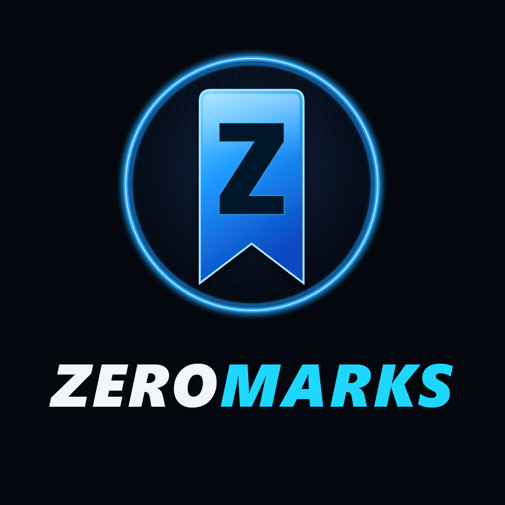
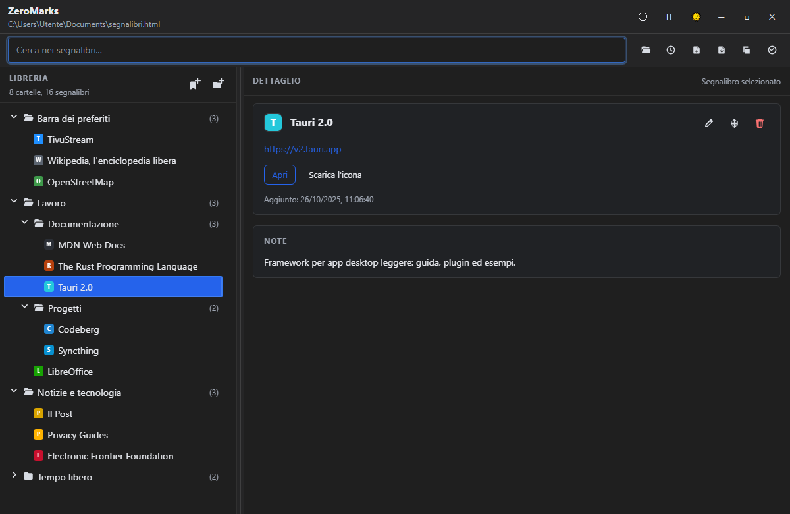

<p align="center"></p>

# ZeroMarks

🇬🇧 [Read in English](README.md)

Un gestore di segnalibri per il desktop che tiene **tutti i tuoi segnalibri in un unico file sul tuo computer**, indipendente dal browser. Li organizzi una volta sola e poi li importi nel browser che usi in quel momento.

ZeroMarks è realizzato da [TivuStream](https://tivustream.com) per i suoi lettori, nella famiglia di strumenti per la privacy Zero…. È basato su
[JustBookmarks](https://github.com/SellswordSoftware/justbookmarks) di SellswordSoftware, con funzioni in
più, correzioni per la sicurezza dei dati e l'interfaccia in italiano (vedi [Cosa cambia](#cosa-cambia)).



## La tua privacy

- **Tutto resta sul tuo computer.** I segnalibri stanno in un normale file HTML di segnalibri scelto da te.
- **Niente account, niente cloud, niente statistiche, nessun tracciamento.** Non viene caricato nulla online.
- **L'app si collega a Internet solo quando lo chiedi tu**: per aggiornare il titolo o l'icona di una pagina,
  o per controllare i link non funzionanti. In quei casi contatta solo i siti dei tuoi segnalibri, senza
  servizi di terze parti.
- L'interfaccia non può raggiungere Internet: la sua politica di sicurezza blocca ogni connessione esterna.

## Funzioni

- Un solo file come riferimento, nel **formato Netscape** che tutti i browser sanno importare ed esportare
- Albero delle cartelle, ricerca immediata, aggiungi / modifica / sposta / elimina, trascinamento, annulla e ripeti
- **Importa e unisci** un altro file di segnalibri: i link già presenti vengono riconosciuti, anche se stanno in altre cartelle
- **Trova duplicati** in tutta la libreria ed elimina le copie in più (`Ctrl+Maiusc+D`)
- **Controlla i link non funzionanti**: pagine che non esistono più, siti spostati, link da verificare a mano (`Ctrl+Maiusc+L`)
- **Ordina le cartelle** per nome, data di aggiunta o sito web, anche con le sottocartelle
- Menu dei **file recenti** (`Ctrl+Maiusc+O`); all'avvio si riapre l'ultimo file
- **Backup automatici** prima di ogni salvataggio, e salvataggio sicuro che non lascia mai un file a metà
- **Si accorge delle modifiche fatte da altri programmi** (Syncthing, Dropbox, editor) e ti fa scegliere se ricaricare o tenere la tua versione
- Conserva tutto ciò che i browser salvano nel file: tag, parole chiave, descrizioni, barra dei preferiti
- Interfaccia in **italiano e inglese** (pulsante `IT / EN` nella barra del titolo)
- Si usa anche solo da tastiera: premi `?` o `F1` per l'elenco delle scorciatoie

## Scarica e installa

Gli installer per Windows sono pubblicati nella [pagina Releases](../../releases/latest).

Windows potrebbe mostrare l'avviso blu "Windows ha protetto il PC" (SmartScreen), perché l'installer non
è firmato digitalmente. Clicca **Ulteriori informazioni → Esegui comunque**. Il codice sorgente completo è
in questo repository.

## Come funziona

1. Esporta i segnalibri dal tuo browser (un file `.html`), oppure crea un file nuovo vuoto.
2. Aprilo nell'app e organizzalo: le modifiche vengono salvate da sole.
3. Importa il file nel browser che vuoi, quando vuoi.

I backup si trovano nella cartella `.zeromarks-backups` accanto al tuo file: gli ultimi 20, al massimo
uno ogni 10 minuti, più uno ogni volta che un altro programma ha modificato il file.

## Cosa cambia

Rispetto al JustBookmarks originale, ZeroMarks:

- conserva tag, parole chiave, descrizioni e altri dati del browser che andavano persi al salvataggio
- salva in modo sicuro (nessun file rovinato se l'app si chiude a metà) e tiene backup automatici
- converte i caratteri speciali nei titoli (per esempio `&#39;` di Chrome)
- all'importazione riconosce i duplicati in tutta la libreria e completa i dati mancanti
- aggiunge trova duplicati, controllo dei link, ordinamento delle cartelle, file recenti, rilevamento
  delle modifiche esterne, la schermata Informazioni e la traduzione italiana
- non chiede più a Google le icone mancanti dei siti (privacy)
- corregge l'esecuzione dei test su Windows

## Riconoscimenti e licenza

Basato su [JustBookmarks](https://github.com/SellswordSoftware/justbookmarks) di **SellswordSoftware**,
distribuito con licenza MIT. Grazie!

Distribuito con [licenza MIT](LICENSE).
Copyright © 2026 SellswordSoftware · Copyright © 2026 TivuStream (modifiche).
I componenti di terze parti e le loro licenze sono elencati in [THIRD-PARTY-NOTICES.txt](THIRD-PARTY-NOTICES.txt).

---

## Sviluppo

È un'app [Tauri](https://tauri.app): l'interfaccia è in JavaScript semplice in `src/`, la parte desktop è
in Rust in `src-tauri/`.

### Requisiti

- Node.js e npm
- Rust e Cargo ([rustup.rs](https://rustup.rs))
- I requisiti di Tauri per il tuo sistema. Su Windows: *Visual Studio C++ Build Tools* e WebView2 (già
  incluso in Windows 10/11). Su Linux: WebKitGTK e pacchetti collegati.

### Comandi principali

```bash
npm install            # installa le dipendenze
npm run tauri dev      # avvia l'app in modalità sviluppo
npm test               # test dell'interfaccia
npm run test:browser   # test nel browser (scarica chrome-headless-shell se serve)
cd src-tauri && cargo test   # test del backend
npm run notices        # rigenera THIRD-PARTY-NOTICES.txt dopo aver cambiato le dipendenze
npm run tauri build    # crea gli installer (src-tauri/target/release/bundle/)
```

### Traduzioni

I testi dell'interfaccia sono scritti in inglese e tradotti tramite `src/shared/i18n/`. I testi italiani
sono in `src/shared/i18n/it.js`: una riga per testo, `"English": "Italiano"`. I testi che mancano nel
file vengono mostrati in inglese.

### Documentazione

- `docs/RENAMING.md`: elenco dei passi per cambiare nome e identificativo dell'app
- `docs/agent-project-context.md`, `docs/frontend-architecture.md`,
  `docs/frontend-maintainability-guidelines.md`, `docs/naf-html-usage-guidelines.md`, `guide.md`
