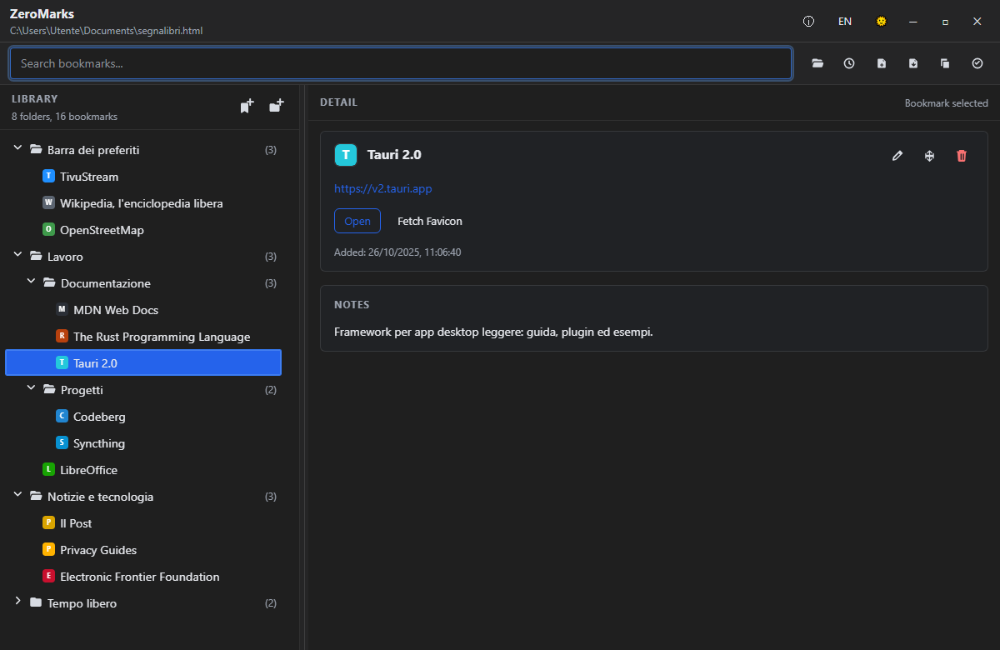

<p align="center"></p>

# ZeroMarks

🇮🇹 [Leggimi in italiano](README.it.md)

A desktop bookmark manager that keeps **all your bookmarks in one plain file on your computer**, independent of any browser. Organize them once, then import them into whichever browser you use today.

ZeroMarks is made by [TivuStream](https://tivustream.com) for its readers, as part of its Zero… family of privacy tools. It is based on
[JustBookmarks](https://github.com/SellswordSoftware/justbookmarks) by SellswordSoftware, with extra
features, safety fixes and an Italian interface (see [What's different](#whats-different)).



## Your privacy

- **Everything stays on your computer.** Bookmarks are kept in a standard bookmarks HTML file that you choose.
- **No accounts, no cloud, no statistics, no tracking.** Nothing is uploaded anywhere.
- **The app goes online only when you ask it to**: to refresh a page title or icon, or to check for dead
  links. It then contacts only the websites of your own bookmarks. No third-party services are used.
- The interface itself cannot reach the internet: its security policy blocks every external connection.

## Features

- One file, one source of truth: the **Netscape bookmark format** that every browser can import and export
- Folder tree, instant search, add / edit / move / delete, drag and drop, undo and redo
- **Import and merge** another bookmark file: links already in your library are recognized, even in other folders
- **Find duplicates** across the whole library and remove the extra copies (`Ctrl+Shift+D`)
- **Check for dead links**: pages that no longer exist, sites that moved, links to verify by hand (`Ctrl+Shift+L`)
- **Sort folders** by name, date added or website, optionally including subfolders
- **Recent files** menu (`Ctrl+Shift+O`); the last file reopens automatically
- **Automatic backups** before every save, and safe saving that never leaves a half-written file
- **Notices changes made by other programs** (sync tools like Syncthing or Dropbox, editors) and lets you reload or keep your version
- Keeps everything browsers store in the file: tags, keywords, descriptions, toolbar folder
- **English and Italian** interface (`IT / EN` button in the title bar)
- Works from the keyboard: press `?` or `F1` for the full list of shortcuts

## Download and install

Installers for Windows are published on the [Releases page](../../releases/latest).

Windows may show a blue "Windows protected your PC" (SmartScreen) message, because the installer is not
code-signed. Click **More info → Run anyway**. The full source code is in this repository.

## How it works

1. Export your bookmarks from your browser (an `.html` file), or create a new empty file.
2. Open it in the app and organize it: changes are saved automatically.
3. Import the file into any browser, whenever you want.

Backups are kept in a `.zeromarks-backups` folder next to your file (the last 20, at most one every
10 minutes, plus one whenever another program changed the file).

## What's different

Compared with the original JustBookmarks, ZeroMarks:

- keeps tags, keywords, descriptions and other browser data that were lost when saving
- saves safely (no corrupted file if the app stops mid-save) and keeps automatic backups
- decodes special characters in titles (for example `&#39;` from Chrome)
- detects duplicates library-wide when importing, and fills in missing details
- adds find duplicates, dead-link check, folder sorting, recent files, external-change detection,
  an About screen and the Italian translation
- no longer asks Google for missing site icons (privacy)
- fixes the test runner on Windows

## Credits and license

Based on [JustBookmarks](https://github.com/SellswordSoftware/justbookmarks) by **SellswordSoftware**,
released under the MIT license. Thank you!

Released under the [MIT license](LICENSE).
Copyright © 2026 SellswordSoftware · Copyright © 2026 TivuStream (modifications).
Third-party components and their licenses are listed in [THIRD-PARTY-NOTICES.txt](THIRD-PARTY-NOTICES.txt).

---

## Development

This is a [Tauri](https://tauri.app) app: the frontend is plain JavaScript in `src/`, the desktop host is
Rust in `src-tauri/`.

### Prerequisites

- Node.js and npm
- Rust and Cargo ([rustup.rs](https://rustup.rs))
- Tauri prerequisites for your OS. On Windows: *Visual Studio C++ Build Tools* and WebView2 (included in
  Windows 10/11). On Linux: WebKitGTK and related packages.

### Common commands

```bash
npm install            # install dependencies
npm run tauri dev      # run the app in development mode
npm test               # frontend tests
npm run test:browser   # browser tests (downloads chrome-headless-shell when needed)
cd src-tauri && cargo test   # backend tests
npm run notices        # regenerate THIRD-PARTY-NOTICES.txt after dependency changes
npm run tauri build    # build the installers (src-tauri/target/release/bundle/)
```

Coverage: `npm run test:coverage`, `npm run test:browser:coverage`, `npm run test:coverage:all`,
`npm run test:coverage:html` (needs `genhtml` from `lcov`).

### Translations

Interface texts are written in English and translated through `src/shared/i18n/`. The Italian texts are
in `src/shared/i18n/it.js`: one line per text, `"English": "Italiano"`. Texts missing from the file are
shown in English.

### Docs

- `docs/RENAMING.md`: checklist for changing the app name and identifier
- `docs/agent-project-context.md`, `docs/frontend-architecture.md`,
  `docs/frontend-maintainability-guidelines.md`, `docs/naf-html-usage-guidelines.md`, `guide.md`
